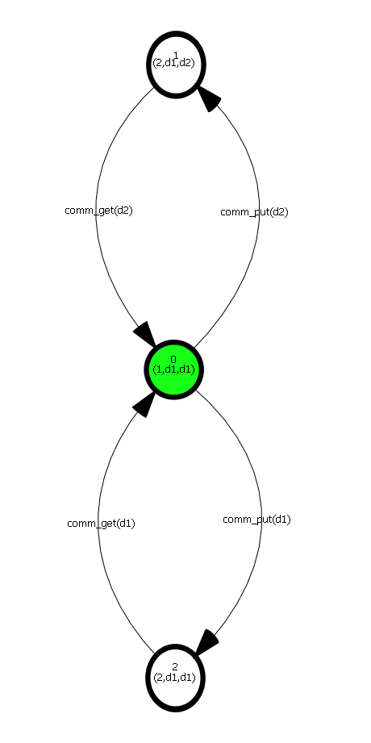
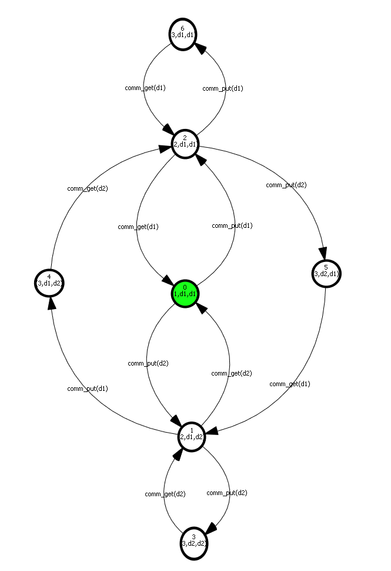
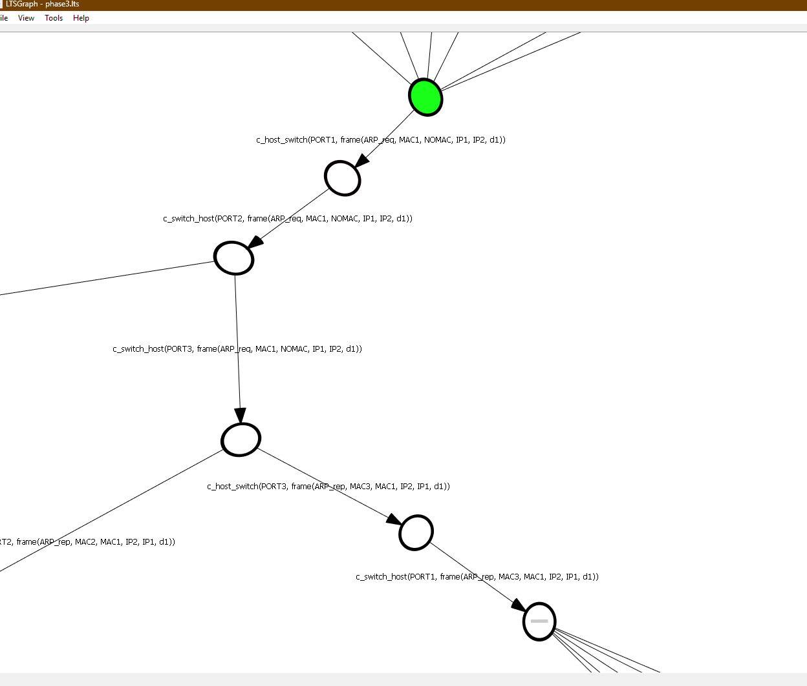

# Formal Modeling of the ARP Protocol using mCRL2

This project models and analyzes the Address Resolution Protocol (ARP) within a Local Area Network (LAN) using the **mCRL2** formal specification language and toolset. It simulates normal network behavior—including MAC learning, broadcasting, and ARP resolution—as well as security vulnerabilities introduced by a malicious actor.

## Project Overview

The system models a switched LAN environment consisting of the following core entities:
* **Switch:** Dynamically learns source MAC addresses, maintains a MAC table, forwards unicast frames to known ports, and floods/broadcasts frames when the destination MAC is unknown.
* **Normal Hosts:** Maintain local ARP tables, resolve IP-to-MAC mappings via ARP Requests (Broadcast) and ARP Replies (Unicast), and exchange data frames.
* **Crazy Host (Attacker):** A non-deterministic malicious node capable of forging ARP Requests/Replies and sending spoofed frames to simulate **ARP Spoofing**, **Man-in-the-Middle (MitM)**, and **Sniffing** attacks.

## Model Architecture & Phases
1. **Basic Switching & Host Communication:** Modeling frame structures (Source/Dest MAC, Source/Dest IP, Payload), MAC table learning, and basic frame forwarding/dropping.
2. **ARP Resolution:** Implementing dynamic ARP table updates starting from empty tables via request/reply cycles.
3. **Adversarial Modeling:** Introducing the *Crazy Host* to observe state-space anomalies and potential attack vectors (e.g., cache poisoning).

## State Space Analysis ($n = 1$ to $n = 3$)

To analyze how the state space scales with the number of hosts ($n$), the model was generated and visualized for three network sizes:

### 1. Network Size $n = 1$


### 2. Network Size $n = 2$


### 3. Network Size $n = 3$


## How to Run
1. Linearize the mCRL2 specification:
   ```bash
   mcrl22lps arp_model.mcrl2 arp_model.lps
   ```
2. Generate the Labelled Transition System (LTS):
   ```bash
   lps2lts arp_model.lps arp_model.lts
   ```
3. Visualize using `ltsgraph`:
   ```bash
   ltsgraph arp_model.lts
   ```